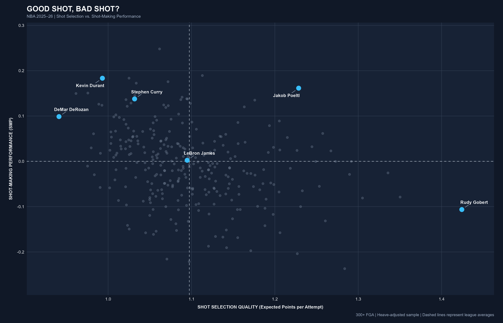

# Good Shot, Bad Shot?
### Evaluating Shot Selection and Shot-Making Performance in the NBA

An independent sports analytics research project using **R, logistic regression, and NBA shot-level data** to examine how shot selection and shot-making contribute to scoring efficiency.

## Project Overview

Traditional basketball statistics, such as field goal percentage (FG%) and effective field goal percentage (eFG%), provide useful information about shooting efficiency. However, they do not fully distinguish between the quality of shots a player attempts and their ability to convert those opportunities.

This project analyzes NBA shot-level data from the **2023–24, 2024–25, and 2025–26 seasons** to estimate expected scoring value and evaluate differences in shooting performance across players.

The central research question is:

**Does attempting higher-value shots necessarily correspond with stronger shot-making performance?**

## Shot Selection vs. Shot-Making Performance

The visualization compares Shot Selection Quality (SSQ) against Shot-Making Performance (SMP) among NBA players with at least 300 field goal attempts during the 2025–26 season.

Each point represents a player, with selected players highlighted to illustrate contrasting shooting profiles. The dashed lines indicate league-average SSQ and zero SMP.

## Methodology

Shot-level data was collected using the `hoopR` package in R.

Six logistic regression models were developed to estimate the probability of a field goal attempt being successful, using variables such as shot distance, shot subtype, time remaining, and shot location characteristics.

The datasets were separated into:

- **2023–24:** Model training
- **2024–25:** Model validation and selection
- **2025–26:** Final testing and player analysis

The selected model achieved a **test Brier score of 0.2247**.

### Performance Metrics

Three metrics were developed to examine shooting performance:

| Metric | Description |
|---|---|
| **Shot Selection Quality (SSQ)** | Average expected points per field goal attempt |
| **Shot-Making Performance (SMP)** | Actual points per attempt minus expected points per attempt |
| **Points Above Expected (PAE)** | Cumulative difference between actual and expected points |

These metrics distinguish between the expected value of a player's shot attempts and their scoring outcomes relative to model predictions.

## Key Findings

- **Shot selection and shot-making:** SSQ and SMP demonstrated a modest negative correlation (*r* = −0.301). This relationship should be interpreted cautiously because SMP is mathematically dependent on SSQ.
- **Expected and actual scoring:** SSQ demonstrated a moderate positive correlation with actual points per attempt (*r* = 0.518).
- **Kevin Durant:** Generated approximately **254.5 points above expected**, demonstrating strong shot-making performance despite a relatively low SSQ.
- **Rudy Gobert:** Recorded a high SSQ of **1.424**, but a negative SMP of **−0.106**, illustrating that high-value shot opportunities do not guarantee above-expected conversion.
- **Spatial analysis:** Shots near the basket generally produced the highest expected scoring values, while shot-making performance relative to expectations varied across court locations.

## Limitations

The model does not account for several important contextual factors, including defensive pressure, defender proximity, and player movement.

Consequently, the developed metrics should be interpreted as descriptive measures of shot value and performance relative to model expectations rather than definitive indicators of individual offensive ability.

## Tools & Technologies

- **R** — Data analysis and statistical modelling
- **hoopR** — NBA shot-level data collection
- **tidyverse / dplyr** — Data cleaning and transformation
- **ggplot2** — Data visualization
- **Logistic Regression (GLM)** — Shot probability modelling
- **R Markdown** — Reproducible analysis and research reporting

## Project Files

| File | Description |
|---|---|
| `Good_Shot_Bad_Shot_Report.pdf` | Full research report, including methodology, results, and discussion |
| `code
